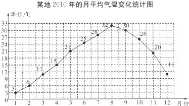

# Mathematics (Grade 5)

**ID**: 354bbe19
**难度**: hard
**题型**: fill_in_the_blank

## 题目
试一试．

（1）$\underline{\hspace{5em}}$月的平均气温最高，$\underline{\hspace{5em}}$月的平均气温最低．从$\underline{\hspace{5em}}$月到$\underline{\hspace{5em}}$月的气温呈上升趋势，从$\underline{\hspace{5em}}$月到$\underline{\hspace{5em}}$月的气温呈下降趋势．
（2）请你计算出全年月平均气温．

## 解答

**答案**: 8, 1, 1, 8, 12

1. Step1:观察统计图，找出气温最高点对应的月份为8月，所以8月的平均气温最高
2. Step2:观察统计图，找出气温最低点对应的月份为1月，所以1月的平均气温最低
3. Step3:观察统计图，从1月开始气温逐渐上升，到8月达到最高，所以从1月到8月的气温呈上升趋势
4. Step4:观察统计图，从8月开始气温逐渐下降，到12月结束，所以从8月到12月的气温呈下降趋势

## 知识点

**知识点**:
  - 单式折线统计图；平均数的含义及求平均数的方法；从统计图表中获取信息．

---
