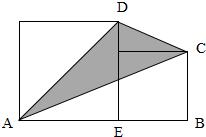

# Mathematics (Grade 5)

**ID**: 501ff6a5
**难度**: hard
**题型**: fill_in_the_blank

## 题目
如图，大正方形边长为8cm，小正方形边长为6cm，则阴影部分的面积是$\underline{\hspace{5em}}$．

## 解答

**答案**: 32平方厘米

1. Step1:明确阴影部分面积的求解公式为S$_{阴影}$=S$_{梯形EBCD}$+S$_{△AED}$-S$_{△ABC}$
2. Step2:根据梯形面积公式S=(a + b)h÷2（其中a、b为上底和下底，h为高），计算梯形EBCD的面积，a = 6cm，b = 8cm，h = 6cm，可得S$_{梯形EBCD}$=(6 + 8)×6÷2
3. Step3:根据三角形面积公式S = ah÷2（其中a为底，h为高），计算△AED的面积，a = 8cm，h = 8cm，可得S$_{△AED}$=8×8÷2
4. Step4:根据三角形面积公式S = ah÷2，计算△ABC的面积，a = 6 + 8cm，h = 6cm，可得S$_{△ABC}$=(6 + 8)×6÷2
5. Step5:将S$_{梯形EBCD}$=(6 + 8)×6÷2、S$_{△AED}$=8×8÷2、S$_{△ABC}$=(6 + 8)×6÷2代入S$_{阴影}$=S$_{梯形EBCD}$+S$_{△AED}$-S$_{△ABC}$，得到S$_{阴影}$=(6 + 8)×6÷2 + 8×8÷2 - (6 + 8)×6÷2
6. Step6:化简S$_{阴影}$=(6 + 8)×6÷2 + 8×8÷2 - (6 + 8)×6÷2，可得S$_{阴影}$=8×8÷2
7. Step7:计算8×8÷2 = 32，单位是平方厘米，所以阴影部分面积是32平方厘米

## 知识点

**知识点**:
  - 组合图形的面积．

---
