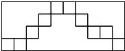

# Mathematics (Grade 5)

**ID**: 53145b3f
**难度**: hard
**题型**: fill_in_the_blank

## 题目
如图，图中的小正方形完全一样，大长方形的周长是56厘米．这个大长方形的面积是$\underline{\hspace{5em}}$平方厘米．

## 解答

**答案**: 160

1. Step1:观察图形，确定长方形的长是10个正方形的边长的和，宽是4个正方形的边长的和
2. Step2:设正方形的边长为x厘米，则长方形的长为10x厘米，宽为4x厘米
3. Step3:根据长方形周长公式C=(a + b)×2（C为周长，a为长，b为宽），已知大长方形周长是56厘米，列出方程(10x + 4x)×2 = 56
4. Step4:解方程(10x + 4x)×2 = 56，先计算括号内为14x，得到14x×2 = 56，即28x = 56，解得x = 2
5. Step5:求出长方形的长为10×2 = 20厘米，宽为4×2 = 8厘米
6. Step6:根据长方形面积公式S = ab（S为面积，a为长，b为宽），计算长方形面积为20×8 = 160平方厘米

## 知识点

**知识点**:
  - 等积变形（位移、割补）．

---
