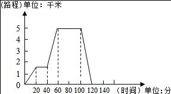

# Mathematics (Grade 5)

**ID**: 55ee0c11
**难度**: hard
**题型**: fill_in_the_blank

## 题目

看图填空
小华骑车从家去相距5千米的图书馆借书，从所给的折线统计图可以看出：
小华去图书馆路上停车$\underline{\hspace{5em}}$分，在图书馆借书用$\underline{\hspace{5em}}$分．
从家中去图书馆，平均速度是每小时$\underline{\hspace{5em}}$千米．
从图书馆返回家中，速度是每小时$\underline{\hspace{5em}}$千米．

## 解答

**答案**: 20, 40, 5, 15

1. Step1:观察折线统计图，去图书馆路上水平线段对应的时间范围是20 - 40分钟，所以停车时间为40 - 20 = 20分钟
2. Step2:在图书馆时路程不变，对应的时间范围是60 - 100分钟，所以借书用时为100 - 60 = 40分钟
3. Step3:从家中去图书馆，总路程为5千米，总用时60分钟，60分钟 = 1小时，根据速度 = 路程÷时间，可得平均速度为5÷1 = 5千米/小时
4. Step4:从图书馆返回家中，路程是5千米，用时为120 - 100 = 20分钟，20分钟 = 1/3小时，根据速度 = 路程÷时间，速度为5÷(1/3) = 15千米/小时

## 知识点

**知识点**:
  - 以一当五（或以上）的条形统计图．

---
