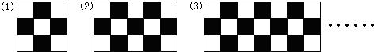

# Mathematics (Grade 5)

**ID**: 5aa85a81
**难度**: hard
**题型**: fill_in_the_blank

## 题目
用同样规格的黑白两种颜色的正方形瓷砖，按下图的方式铺地板．第4个图形中有黑色瓷砖$\underline{\hspace{5em}}$块；第n个图形中需要黑色瓷砖$\underline{\hspace{5em}}$块；当黑色瓷砖有301块时，它是$\underline{\hspace{5em}}$号图形．

## 解答

**答案**: 13, 3n+1, 100

1. Step1:观察图形，第一个图形有黑色瓷砖3×1 + 1 = 4块
2. Step2:第二个图形有黑色瓷砖3×2 + 1 = 7块
3. Step3:第三个图形有黑色瓷砖3×3 + 1 = 10块
4. Step4:总结规律，得出第n个图形中需要黑色瓷砖3n + 1块
5. Step5:当n = 4时，计算黑色瓷砖数量为3×4 + 1 = 13块
6. Step6:当黑色瓷砖有301块时，列方程3n + 1 = 301，得到3n = 300，解得n = 100

## 知识点

**知识点**:
  - 数与形结合的规律．

---
