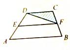

# Mathematics (Grade 5)

**ID**: 5d69ec30
**难度**: hard
**题型**: fill_in_the_blank

## 题目
如图，梯形ABCD的面积为48平方分米，上底长是下底的$\frac{3}{5}$，E，F分别是AD和BC的中点，那么图中的阴影部分的面积是 $\underline{\hspace{5em}}$ 平方分米．

## 解答

**答案**: 9

1. Step1:设梯形的高为h，因为E、F分别是AD和BC的中点，所以三角形ABE、三角形BEF、三角形DEF、三角形DFC的高都是$rac{1}{2}$h
2. Step2:根据三角形面积公式分别得出S$_{△ABE}$=$rac{1}{2}$×$rac{1}{2}$AB×h，S$_{△BEF}$=$rac{1}{2}$×$rac{1}{2}$×EF×h，S$_{△DEF}$=$rac{1}{2}$×$rac{1}{2}$×EF×h，S$_{△DFC}$=$rac{1}{2}$×$rac{1}{2}$×CD×h
3. Step3:由S$_{△ABE}$+S$_{△BEF}$+S$_{△DEF}$+S$_{△DFC}$=48，可得$rac{1}{2}$×$rac{1}{2}$AB×h+$rac{1}{2}$×$rac{1}{2}$×EF×h+$rac{1}{2}$×$rac{1}{2}$×EF×h+$rac{1}{2}$×$rac{1}{2}$×CD×h=48
4. Step4:因为AB+CD=2EF，CD=$rac{3}{5}$AB，所以将AB和EF都用CD表示，经过化简得到$rac{16}{3}$CD×h=48×4，进而得出CD×h=36
5. Step5:因为阴影部分面积S$_{△DFC}$=$rac{1}{2}$×$rac{1}{2}$×CD×h，将CD×h=36代入，可得S$_{△DFC}$=$rac{1}{4}$×36=9（平方分米）

## 知识点

**知识点**:
  - 组合图形的面积

---
