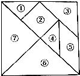

# Mathematics (Grade 5)

**ID**: 7c849020
**难度**: hard
**题型**: fill_in_the_blank

## 题目
如图是一个七巧板的示意图：
（1）用三块拼，拼一个三角形，可以选择图形$\underline{\hspace{5em}}$      ；拼一个平行四边形，可以选择图形$\underline{\hspace{5em}}$      ；拼一个梯形，可以选择图形$\underline{\hspace{5em}}$      ．
（2）用四块拼，拼一个三角形，可以选择图形$\underline{\hspace{5em}}$      ；拼一个平行四边形，可以选择图形$\underline{\hspace{5em}}$      ；拼一个梯形．可以选择图形$\underline{\hspace{5em}}$      ．

## 解答

**答案**: ①④⑤, ①②④, ①②④, ①④⑤⑥, ①②④⑤, ①②④⑤

1. Step1:观察七巧板图形，明确①和④是同样的等腰直角三角形，⑥和⑦是同样的等腰直角三角形等特点
2. Step2:对于用三块拼三角形，根据图形特点和拼接可能性，确定可以选择图形①④⑤
3. Step3:对于用三块拼平行四边形，根据图形特点和拼接规则，确定可以选择图形①②④
4. Step4:对于用三块拼梯形，结合图形特征和拼接方式，确定可以选择图形①②④
5. Step5:对于用四块拼三角形，综合考虑图形情况，确定可以选择图形①④⑤⑥
6. Step6:对于用四块拼平行四边形，依据图形特点和拼接要求，确定可以选择图形①②④⑤
7. Step7:对于用四块拼梯形，根据图形性质和拼接思路，确定可以选择图形①②④⑤

## 知识点

**知识点**:
  - 图形的拼组

---
