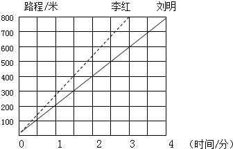

# Mathematics (Grade 5)

**ID**: 8114f0c4
**难度**: hard
**题型**: fill_in_the_blank

## 题目
下面是李红和刘明两人校运会上800米赛跑行程图，看图回答问题．

（1）跑完全程李红用了 $\underline{\hspace{5em}}$ 分钟．
（2）李红到达终点后，刘明再跑 $\underline{\hspace{5em}}$ 分钟才到达终点．
（3）李红平均每分钟跑 $\underline{\hspace{5em}}$ 米，刘明平均每分钟跑 $\underline{\hspace{5em}}$ 米．
（4） $\underline{\hspace{5em}}$ 分钟后，两人相距200米．

## 解答

**答案**: 3, 1, 266\\frac{2}{3}, 200, 3

1. Step1:观察行程图可知，李红跑完全程对应的时间是3分钟，所以第一个空答案为3
2. Step2:刘明跑完全程用4分钟，李红用3分钟，4 - 3 = 1，所以李红到达终点后，刘明再跑1分钟才到达终点，第二个空答案为1
3. Step3:李红跑的路程是800米，时间是3分钟，800÷3 = 266rac{2}{3}，所以李红平均每分钟跑266rac{2}{3}米；刘明跑的路程是800米，时间是4分钟，800÷4 = 200，所以刘明平均每分钟跑200米，第三、四个空答案分别为266rac{2}{3}、200
4. Step4:两人的速度差为266rac{2}{3} - 200，路程差为200米，200÷(266rac{2}{3} - 200) = 3，所以3分钟后两人相距200米，第五个空答案为3

## 知识点

**知识点**:
  - 复式折线统计图

---
