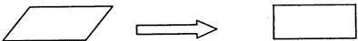

# Mathematics (Grade 5)

**ID**: 86fe1486
**难度**: hard
**题型**: fill_in_the_blank

## 题目
(如图)请回忆老师引导你推导平行四边形面积公式进的情境，给(1)、(2)填空；(3)计算．

(1)以将平行四边形转化为长方形来推导平行四边形的面积公式．把平行四边形转化成长方形采用的方法是：______
(2)观察转化前的平行四边形与转化后的长方形，你发现了什么？(请写在下面的横线上，至少写三条)______
(3)计算上面平行四边形的面积，(先动手在图中量出计算时需要的数据，再算出它的面积)

## 解答

**答案**: 剪拼法, 长方形的长就是平行四边形的底、长方形的高就是平行四边形的高、长方形的面积等于平行四边形的面积, 2平方厘米

1. Step1:根据将平行四边形转化为长方形的操作过程，可知从左边沿平行四边形的高剪下一个直角三角形，拼到平行四边形的右侧形成长方形，所以把平行四边形转化成长方形采用的方法是剪拼法
2. Step2:观察转化前后图形，可得长方形的长就是平行四边形的底、长方形的高就是平行四边形的高、长方形的面积等于平行四边形的面积
3. Step3:动手量得平行四边形的底是2厘米，高是1厘米，根据平行四边形面积公式面积 = 底×高，计算得出面积为2×1 = 2平方厘米

## 知识点

**知识点**:
  - 平行四边形的面积;长方形、正方形的面积．

---
