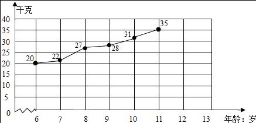

# Mathematics (Grade 5)

**ID**: 882b6479
**难度**: hard
**题型**: fill_in_the_blank

## 题目
如图是小明从6岁到11岁生日体检时的体重情况

根据统计图回答下面的问题．
（1）从8岁到11岁小明的体重增加了$\underline{\hspace{5em}}$千克．
（2）小明从$\underline{\hspace{5em}}$岁到$\underline{\hspace{5em}}$的体重增长最快，从$\underline{\hspace{5em}}$岁到$\underline{\hspace{5em}}$的体重增长最慢．
（3）预测小明12岁时的体重是$\underline{\hspace{5em}}$千克．
（4）从6岁到11岁五年中，小明的体重平均每年增长了$\underline{\hspace{5em}}$千克．

## 解答

**答案**: 8, 7, 8, 8, 9, 39, 3

1. Step1:找到8岁时体重为27千克，11岁时体重为35千克，计算35 - 27 = 8千克，得出从8岁到11岁小明体重增加量为8千克
2. Step2:观察折线统计图，发现7 - 8岁折线走势陡，所以7 - 8岁体重增长最快；8 - 9岁折线走势平缓，所以8 - 9岁体重增长最慢
3. Step3:看到从9岁到10岁增长3千克，从10岁到11岁增长4千克，预计从11岁到12岁增长4千克，计算35 + 4 = 39千克，得到预测小明12岁时体重为39千克
4. Step4:计算增长的总重量为(22 - 20) + (27 - 22) + (28 - 27) + (31 - 28) + (35 - 31) = 15千克，再除以5年，即15÷5 = 3千克，得出小明的体重平均每年增长3千克

## 知识点

**知识点**:
  - 从统计图表中获取信息；平均数的含义及求平均数的方法．

---
