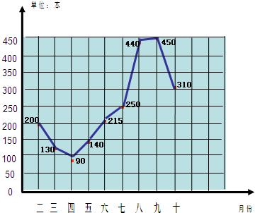

# Mathematics (Grade 5)

**ID**: 8a60c839
**难度**: hard
**题型**: fill_in_the_blank

## 题目
育才书店 二月至十月图书销售变化情况统计图．

（1）从图中可知，$\underline{\hspace{5em}}$销售量最高，是$\underline{\hspace{5em}}$本；$\underline{\hspace{5em}}$的销售量最低，是$\underline{\hspace{5em}}$本．销售量最高和最少的月份相差$\underline{\hspace{5em}}$本．
（2）从$\underline{\hspace{5em}}$月到$\underline{\hspace{5em}}$月的销售量持续上升．

## 解答

**答案**: 九月份, 450, 四月份, 90, 360, 四, 九

1. Step1:观察统计图，找到折线的最高点对应的月份为九月，其销售量为450本，所以销售量最高的是九月份，是450本
2. Step2:观察统计图，找到折线的最低点对应的月份为四月，其销售量为90本，所以销售量最低的是四月份，是90本
3. Step3:计算销售量最高的九月和销售量最低的四月相差的数量，450 - 90 = 360本
4. Step4:观察统计图中折线的走势，发现从四月到九月折线一直上升，即从四月到九月的销售量持续上升

## 知识点

**知识点**:
  - 单式折线统计图；从统计图表中获取信息．

---
