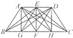

# Mathematics (Grade 5)

**ID**: 8ef0bfc1
**难度**: hard
**题型**: fill_in_the_blank

## 题目
如图，已知四边形ABCD是一个等腰梯形，点E、F分别是上下两底的中点，点G、H分别是BF、CF的中点，且BC=2AD，则图中以A、B、C、D、E、F、G、H为顶点的所有三角形中，与△HEC面积相等的三角形有______个．

## 解答

**答案**: 21

1. Step1:明确根据等底等高的三角形面积相等这一原理来解题
2. Step2:确定以AE为底，找出与△HEC面积相等的三角形，个数为5
3. Step3:确定以DE为底，找出与△HEC面积相等的三角形，个数为5
4. Step4:确定以BG为底，找出与△HEC面积相等的三角形，个数为3
5. Step5:确定以GF为底，找出与△HEC面积相等的三角形，个数为3
6. Step6:确定以FH为底，找出与△HEC面积相等的三角形，个数为3
7. Step7:确定以CH为底，找出与△HEC面积相等的三角形，个数为2
8. Step8:将上述各类底对应的与△HEC面积相等的三角形个数相加，即5+5+3+3+3+2=21

## 知识点

**知识点**:
  - 组合图形的计数．

---
