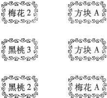

# Mathematics (Grade 5)

**ID**: 94553631
**难度**: hard
**题型**: fill_in_the_blank

## 题目
从6张牌中任意摸出一张牌．

（1）摸出“2”的可能性是$\underline{\hspace{5em}}$．
（2）摸出“3”的可能性是$\underline{\hspace{5em}}$．
（3）摸出“A”的可能性是$\underline{\hspace{5em}}$．
（4）摸出“梅花”的可能性是$\underline{\hspace{5em}}$．
（5）摸出“黑桃”的可能性是$\underline{\hspace{5em}}$．
（6）摸出“方块A”的可能性是$\underline{\hspace{5em}}$．

## 解答

**答案**: 1/3, 1/6, 1/2, 1/3, 1/3, 1/3

1. Step1:明确牌的总数为6张
2. Step2:数出数字2的牌有2张，计算摸出“2”的可能性为2÷6 = 1/3
3. Step3:数出数字3的牌有1张，计算摸出“3”的可能性为1÷6 = 1/6
4. Step4:数出字母A的牌有3张，计算摸出“A”的可能性为3÷6 = 1/2
5. Step5:数出花色为梅花的牌有2张，计算摸出“梅花”的可能性为2÷6 = 1/3
6. Step6:数出花色为黑桃的牌有2张，计算摸出“黑桃”的可能性为2÷6 = 1/3
7. Step7:数出“方块A”的牌有2张，计算摸出“方块A”的可能性为2÷6 = 1/3

## 知识点

**知识点**:
  - 简单事件发生的可能性求解．

---
