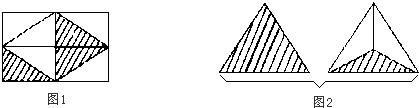

# Mathematics (Grade 5)

**ID**: 9a56c046
**难度**: hard
**题型**: fill_in_the_blank

## 题目
用分数表示各图的阴影部分．

（1）图1阴影部分占整个长方形的$\underline{\hspace{5em}}$，分数单位是$\underline{\hspace{5em}}$，有$\underline{\hspace{5em}}$个这样的单位
（2）图2阴影部分是$\underline{\hspace{5em}}$，分数单位是$\underline{\hspace{5em}}$，有$\underline{\hspace{5em}}$个这样的单位．

## 解答

**答案**: $\frac{3}{8}$, $\frac{1}{8}$, 3, $\frac{4}{3}$, $\frac{1}{3}$, 4

1. Step1:观察图1，将长方形看作一个整体，平均分成了8份，阴影部分占3份，根据分数的意义，可得阴影部分占整个长方形的$\frac{3}{8}$
2. Step2:根据分数单位的定义，$\frac{3}{8}$的分母是8，所以分数单位是$\frac{1}{8}$
3. Step3:因为$\frac{3}{8}$的分子是3，所以有3个这样的分数单位
4. Step4:观察图2，将一个三角形看作一个整体，每个三角形平均分成3份，两个三角形共6份，阴影部分占4份，所以阴影部分是$\frac{4}{3}$
5. Step5:根据分数单位的定义，$\frac{4}{3}$的分母是3，所以分数单位是$\frac{1}{3}$
6. Step6:因为$\frac{4}{3}$的分子是4，所以有4个这样的分数单位

## 知识点

**知识点**:
  - 分数的意义、读写及分类．

---
