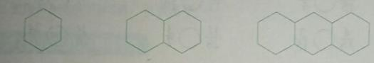

# Mathematics (Grade 5)

**ID**: 9ff71ad6
**难度**: hard
**题型**: fill_in_the_blank

## 题目
用小棒按照下图的方式摆图形．

 (1)摆1个六边形需要(    )根小棒，摆2个六边形需要(    )根小棒，摆3个六边形需要(    )根小棒．
 (2)照这样下去，摆4个六边形需要多少根小棒？摆8个呢？
 (3)186个小棒可以摆多少个六边形？

## 解答

**答案**: 6, 11, 16, 21, 41, 37

1. Step1:观察图形可知，摆1个六边形需要6根小棒
2. Step2:摆2个六边形时，有1根小棒共用，所以需要6×2 - 1 = 11根小棒
3. Step3:摆3个六边形时，有2根小棒共用，所以需要6×3 - 2 = 16根小棒
4. Step4:总结规律，摆n个六边形需要的小棒数为6n - (n - 1)，化简得到5n + 1
5. Step5:当n = 4时，代入规律式子5n + 1，即5×4 + 1 = 21根小棒
6. Step6:当n = 8时，代入规律式子5n + 1，即5×8 + 1 = 41根小棒
7. Step7:设186个小棒可以摆n个六边形，根据规律列方程5n + 1 = 186
8. Step8:解方程5n + 1 = 186，先移项得到5n = 186 - 1 = 185，再解得n = 185÷5 = 37个

## 知识点

**知识点**:
  - --

---
