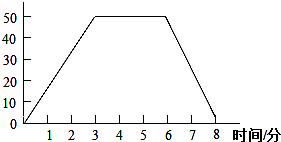

# Mathematics (Grade 5)

**ID**: a642355b
**难度**: hard
**题型**: fill_in_the_blank

## 题目
如图是35路公共汽车从车站开往新村百货大楼的行驶情况．
（1）35路公共汽车从车站到新村百货大楼共行驶了$\underline{\hspace{5em}}$分．
（2）从$\underline{\hspace{5em}}$分到$\underline{\hspace{5em}}$分，汽车行驶速度在加快；从$\underline{\hspace{5em}}$分到$\underline{\hspace{5em}}$分，汽车行驶速度在减慢．
（3）从$\underline{\hspace{5em}}$分到$\underline{\hspace{5em}}$分，汽车行驶速度保持不变，是$\underline{\hspace{5em}}$米/分．

## 解答

**答案**: 8, 0, 3, 6, 8, 3, 6, 50

1. Step1:观察统计图，确定35路公共汽车从车站到新村百货大楼行驶的总时长，得出共行驶了8分钟，这是第一个答案
2. Step2:观察折线统计图中曲线的上升趋势，确定汽车行驶速度加快的时间段为0分到3分，这是第二、三个答案
3. Step3:观察折线统计图中曲线的下降趋势，确定汽车行驶速度减慢的时间段为6分到8分，这是第四、五个答案
4. Step4:观察折线统计图中曲线持平的趋势，确定汽车行驶速度保持不变的时间段为3分到6分，且速度为50米/分，得到第六、七、八个答案

## 知识点

**知识点**:
  - 单式折线统计图；从统计图表中获取信息．

---
