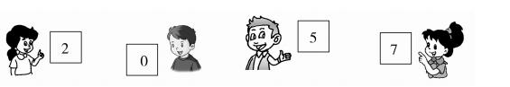

# Mathematics (Grade 5)

**ID**: b0994993
**难度**: hard
**题型**: fill_in_the_blank

## 题目
从下面的数字中选出三个数字， 按要求组成三位数。（每题写出一个即可）

1.既是3的倍数，又是奇数： $\underline{\hspace{5em}}$ ；
2.同时是2和3的倍数： $\underline{\hspace{5em}}$ ；
3.同时是3和5的倍数： $\underline{\hspace{5em}}$ ；
4.同时是2、3和5的倍数： $\underline{\hspace{5em}}$ 。

## 解答

**答案**: 207, 720, 705, 750

1. Step1:明确可使用的数字为0、2、5、7，要组成三位数。
2. Step2:根据排列组合，写出用0、2、5、7组成的所有三位数：205，207，250，257，270，275，520，527，502，507，572，570，720，725，702，705，750，752。
3. Step3:根据奇数的特征（个位是奇数）以及3的倍数特征（各个数位上数字之和是3的倍数），从所有三位数中找出既是3的倍数又是奇数的数，如207、507、705，任选一个，这里选207。
4. Step4:根据2的倍数特征（个位是偶数）以及3的倍数特征，从所有三位数中找出同时是2和3的倍数的数，如270、702、720、570、750，任选一个，这里选720。
5. Step5:根据5的倍数特征（个位是0或5）以及3的倍数特征，从所有三位数中找出同时是3和5的倍数的数，如270、720、570、750、705，任选一个，这里选705。
6. Step6:综合2、3、5的倍数特征（个位是0且各个数位上数字之和是3的倍数），从所有三位数中找出同时是2、3和5的倍数的数，如720、570、750，任选一个，这里选750。

## 知识点

**知识点**:
  - 2、3、5、9的倍数特征

---
