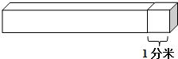

# Mathematics (Grade 5)

**ID**: b1eefbe3
**难度**: hard
**题型**: fill_in_the_blank

## 题目
填表．如图一根长方体木块，表面积是80平方分米，它的横截面是边长1分米的正方形，工人师傅每次都锯下一个棱长1分米的小正方体木块．
$\begin{array}{|c|c|c|c|c|c|}
\hline
锯下木块的个数 & 1 & 2 & 3 & … &  \\ \hline
减少的面积（平方分米） & 4 &  &  & … & 76 \\ \hline
剩下木块的表面积（平方分米） & 76 &  &  & … &  \\ \hline
\end{array}$

## 解答

**答案**: 19, 8, 12, 72, 68, 4

1. Step1:分析锯下木块的规律，每锯下一个棱长1分米的小正方体木块，长方体木块减少边长1分米的正方形4个面的面积，减少的面积为1×1×4 = 4平方分米
2. Step2:计算锯下2个木块时减少的面积，因为锯下2个木块，减少的面是2×4个，所以减少的面积为1×1×8 = 8平方分米
3. Step3:计算锯下2个木块时剩下木块的表面积，用原来的表面积80平方分米减去锯下2个木块减少的8平方分米，即80 - 8 = 72平方分米
4. Step4:计算锯下3个木块时减少的面积，减少的面是3×4个，所以减少的面积为1×1×12 = 12平方分米
5. Step5:计算锯下3个木块时剩下木块的表面积，用原来的表面积80平方分米减去锯下3个木块减少的12平方分米，即80 - 12 = 68平方分米
6. Step6:已知减少的面积为76平方分米，因为每次减少4平方分米，所以锯下木块的个数为76÷4 = 19个
7. Step7:计算剩下木块的表面积，用原来的表面积80平方分米减去减少的76平方分米，即80 - 76 = 4平方分米

## 知识点

**知识点**:
  - 数与形结合的规律

---
