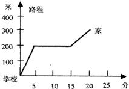

# Mathematics (Grade 5)

**ID**: b2cb39fa
**难度**: hard
**题型**: fill_in_the_blank

## 题目
如图描述了小明放学回家的行程情况，根据图回答如下问题：
（1）小明放学后是径直回家的吗？
（2）从图中可以看出小明在路上逗留了$\underline{\hspace{5em}}$分钟．
（3）小明家离学校有$\underline{\hspace{5em}}$米路．
（4）小明前5分钟的平均速度是每分钟$\underline{\hspace{5em}}$米．
（5）编一个小明放学回家的故事，使得故事情节与图中描述的情况一致．

## 解答

**答案**: 否, 10, 300, 40, 小明放学回家，以某一速度匀速行进，用了5分钟到了书店；在书店买书用了10分钟；随后往家赶，但仍保持匀速行进，结果用了5分钟就赶回家。

1. Step1:观察折线统计图中折线的幅度，发现不是直接从学校到家的直线，得出小明放学后没有径直回家，答案为否
2. Step2:找到统计图中折线与时间轴相持平的线段，用15减去5，即15 - 5 = 10，得出小明在路上逗留了10分钟
3. Step3:看到在距离学校300米处折线到达终点，得出小明家离学校有300米
4. Step4:已知小明在前5分钟行了200米，用200除以5，即200÷5 = 40，得出小明前5分钟的平均速度是每分钟40米
5. Step5:编写故事为小明放学回家，以某一速度匀速行进，用了5分钟到了书店；在书店买书用了10分钟；随后往家赶，但仍保持匀速行进，结果用了5分钟就赶回家

## 知识点

**知识点**:
  - 单式折线统计图；简单的行程问题；从统计图表中获取信息．

---
