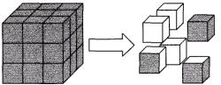

# Mathematics (Grade 5)

**ID**: b63fdb07
**难度**: hard
**题型**: fill_in_the_blank

## 题目
一个大正方体由27个小正方体搭成（如图），把它的表面涂上颜色后，再散开，三面涂色的小正方体有$\underline{\hspace{5em}}$个，两面涂色的小正方体有$\underline{\hspace{5em}}$个，一面涂色的小正方体有$\underline{\hspace{5em}}$个，不涂色的小正方体有$\underline{\hspace{5em}}$个．

## 解答

**答案**: 8, 12, 6, 1

1. Step1:由27=3×3×3，得出大正方体每条棱上有3个小正方体
2. Step2:由于三面涂色的小正方体在大正方体的顶点处，大正方体有8个顶点，所以三面涂色的小正方体有8个
3. Step3:两面涂色的小正方体在棱的中间，每条棱上有(3 - 2)个，大正方体有12条棱，所以两面涂色的小正方体有(3 - 2)×12 = 12个
4. Step4:一面涂色的小正方体在每个面的中间，每个面有1×1个，大正方体有6个面，所以一面涂色的小正方体有1×6 = 6个
5. Step5:用小正方体的总数27减去三面涂色的8个、两面涂色的12个、一面涂色的6个，得出不涂色的小正方体有27 - 8 - 12 - 6 = 1个

## 知识点

**知识点**:
  - 简单的立方体切拼问题；染色问题．

---
