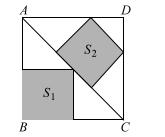

# Mathematics (Grade 5)

**ID**: baf60002
**难度**: hard
**题型**: fill_in_the_blank

## 题目
如下图，边长为6dm的大正方形中有两个小正方形，若两个小正方形的面积分别为$S_{1}$，$S_{2}$，则$S_{1}$+$S_{2}$的值为多少？

## 解答

**答案**: 9, 8, 17

1. Step1:根据小正方形上面和右面的两个小等腰直角三角形，可知S1小正方形的边长为大正方形边长的一半，大正方形边长为6dm，所以S1小正方形边长为3dm，其面积S1=3×3=9
2. Step2:因为S2小正方形的边长与上、下两个小等腰直角三角形的直角边都相等，先求大正方形对角线AC的长度，AC = $\sqrt{6² + 6²}$ = $6\sqrt{2}$dm，所以S2小正方形的边长为1/3×$6\sqrt{2}$ = $2\sqrt{2}$dm，其面积S2 = $2\sqrt{2}$×$2\sqrt{2}$ = 8
3. Step3:将S1和S2的面积相加，S1 + S2 = 9 + 8 = 17

## 知识点

**知识点**:
  - 长方形与正方形的面积

---
