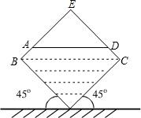

# Mathematics (Grade 5)

**ID**: bb4c7b7d
**难度**: hard
**题型**: fill_in_the_blank

## 题目
一个边长为12米的正方体水箱内部已注入一些水，若将水箱沿着某条边旋转，使得正方体的两个面与地面的夹角都是45°，此时水面标记在A点．如图所示为此水箱由正前方往后看之视图．若再需添加384立方米的水才能将此水箱注满．请问AB之长为多少米？

## 解答

**答案**: 4

1. Step1:根据图形可知△ADE是等腰直角三角形，所以AE = DE
2. Step2:设AB = x，因为正方体边长为12米，所以AE = 12 - x
3. Step3:没水部分的体积为384立方米，且没水部分体积V$_{空}$=s$_{△ADE}$×边长，其中s$_{△ADE}$=$rac{1}{2}×$AE×DE，边长为12米，所以V$_{空}$=$rac{1}{2}×$（12 - x）×（12 - x）×12 = 384
4. Step4:求解方程$rac{1}{2}×$（12 - x）$^{2}$×12 = 384，得到x = 4，即AB的长为4米

## 知识点

**知识点**:
  - 组合图形的体积．

---
