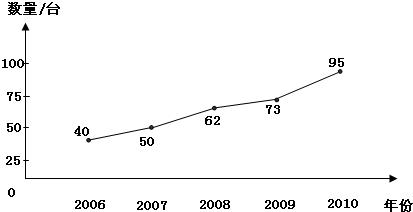

# Mathematics (Grade 5)

**ID**: c206da79
**难度**: hard
**题型**: fill_in_the_blank

## 题目
明元小区2006-2010年每一百户居民电脑平均拥有量如下图．

（1）这是$\underline{\hspace{5em}}$统计图．
（2）明元小区2009年每一百户居民平均拥有电脑$\underline{\hspace{5em}}$台．
（3）$\underline{\hspace{5em}}$年到$\underline{\hspace{5em}}$年电脑平均拥有量增长的幅度最小．$\underline{\hspace{5em}}$年到$\underline{\hspace{5em}}$年电脑平均拥有量增长的幅度最大．
（4）根据图上的信息，你能预测2011年百花小区每一百人电脑平均拥有量大约$\underline{\hspace{5em}}$台．说说理由：$\underline{\hspace{5em}}$．

## 解答

**答案**: 折线, 73, 2006, 2007, 2009, 2010, 120, 因为2009-2010年增长18台，根据这个规律95台在增加20台大约是120台。

1. Step1:观察统计图的特征，根据折线统计图的特点，得出这是折线统计图
2. Step2:查看统计图中2009年对应的数量，可知2009年每一百户居民平均拥有电脑73台
3. Step3:观察统计图中各年之间折线的坡度，发现2006 - 2007年折线坡度最缓，所以2006年到2007年电脑平均拥有量增长的幅度最小
4. Step4:继续观察统计图中各年之间折线的坡度，看到2009 - 2010年折线坡度最陡，因此2009年到2010年电脑平均拥有量增长的幅度最大
5. Step5:分析2009 - 2010年电脑平均拥有量的增长情况，2009年是73台，2010年是95台，增长了95 - 73 = 22台，近似看作增长20台，按照此规律，预测2011年在2010年95台的基础上增加20台，大约是120台
6. Step6:总结预测理由为因为2009 - 2010年增长18台（近似看作20台），根据这个规律95台再增加20台大约是120台

## 知识点

**知识点**:
  - 单式折线统计图；从统计图表中获取信息．

---
