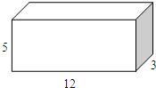

# Mathematics (Grade 5)

**ID**: c40c06c5
**难度**: hard
**题型**: fill_in_the_blank

## 题目
看图计算（单位：cm）
（1）前面面积： $\underline{\hspace{5em}}$ ．
（2）最小面积： $\underline{\hspace{5em}}$ ．
（3）表面积： $\underline{\hspace{5em}}$ ．

## 解答

**答案**: 36平方厘米, 15平方厘米, 222平方厘米

1. Step1:根据前面的面积等于长方体的长乘高，长为12cm，高为3cm，可得前面面积为12×3 = 36平方厘米
2. Step2:根据最小面的面积等于长方体的宽乘高，宽为3cm，高为5cm，可得最小面面积为3×5 = 15平方厘米
3. Step3:根据长方体的表面积S=(ab + ah + bh)×2，其中a = 12cm，b = 3cm，h = 5cm，代入可得(12×3 + 12×5 + 3×5)×2=(36 + 60 + 15)×2 = 111×2 = 222平方厘米

## 知识点

**知识点**:
  - 长方体和正方体的表面积;长方体的特征

---
