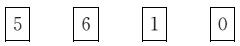

# Mathematics (Grade 5)

**ID**: c8980cc0
**难度**: hard
**题型**: fill_in_the_blank

## 题目
从下面的4张数字卡片中选出两张按要求组成两位数。

1.质数： $\underline{\hspace{5em}}$ 
2.合数： $\underline{\hspace{5em}}$ 
3.2的倍数： $\underline{\hspace{5em}}$ 
4.3的倍数： $\underline{\hspace{5em}}$ 
5.5的倍数： $\underline{\hspace{5em}}$ 
6.既是3的倍数又是5的倍数： $\underline{\hspace{5em}}$ 
7.既是2的倍数又是5的倍数： $\underline{\hspace{5em}}$ 
8.既是2的倍数又是3的倍数： $\underline{\hspace{5em}}$ 
9.同时是2、3、5的倍数： $\underline{\hspace{5em}}$

## 解答

**答案**: 61, 51、50、56、10、16、15、65、60, 50、10、56、16、60, 51、15、60, 50、10、15、65、60, 60、15, 50、60、10, 60, 60

1. Step1:明确两位数由5、6、1、0中的两个数字组成且0不能在首位，列举出所有可能的两位数为56、51、50、65、61、60、15、16、10
2. Step2:根据质数定义，只有1和它本身两个因数的自然数为质数，得出质数为61
3. Step3:依据合数定义，除了能被1和本身整除外，还能被其他数（0除外）整除的自然数为合数，确定合数为51、50、56、10、16、15、65、60
4. Step4:因为2的倍数的末尾数字是偶数，找出2的倍数为50、10、56、16、60
5. Step5:由于3的倍数的特征是十位与个位数字之和是3的倍数，得到3的倍数为51、15、60
6. Step6:根据5的倍数的个位只能是0或5，确定5的倍数为50、10、15、65、60
7. Step7:既是3的倍数又是5的倍数的数，需同时满足是3的倍数和5的倍数的特征，得出是60、15
8. Step8:既是2的倍数又是5的倍数的数，个位数字必须是0，所以是50、60、10
9. Step9:既是2的倍数又是3的倍数的数，要同时符合2的倍数和3的倍数的条件，即为60
10. Step10:同时是2、3、5的倍数的数，需满足个位是0且十位与个位数字之和是3的倍数，答案是60

## 知识点

**知识点**:
  - 2、3、5、9的倍数特征;质数合数的认识

---
