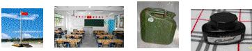

# Mathematics (Grade 5)

**ID**: ca6d8bc5
**难度**: hard
**题型**: fill_in_the_blank

## 题目
在横线里填上适当的单位名称：

旗杆高15______ 
教室面积80______  
油箱容积16______ 
一瓶墨水60______．

## 解答

**答案**: 米, 平方米, 升, 毫升

1. Step1:旗杆是高度相关的描述，属于长度范畴，结合数据15，常用长度单位中米符合实际情况，所以旗杆高15米
2. Step2:教室描述的是面积，常用面积单位有平方米等，数据是80，所以教室面积80平方米
3. Step3:油箱说的是容积，常用容积单位有升等，数据为16，所以油箱容积16升
4. Step4:一瓶墨水描述的是其容量，即体积，常用体积单位有毫升等，数据是60，所以一瓶墨水60毫升

## 知识点

**知识点**:
  - 根据情景选择合适的计量单位．

---
