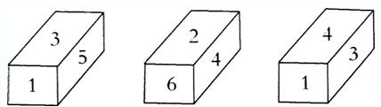

# Mathematics (Grade 5)

**ID**: d49aae94
**难度**: hard
**题型**: fill_in_the_blank

## 题目
有一个小长方体，在它的六个面上分别写有“1”到“6”六个数字，观察下面的图片回答问题．

（1）与1相对的数字是$\underline{\hspace{5em}}$．
（2）与5相对的数字是$\underline{\hspace{5em}}$．
（3）与3相对的数字是$\underline{\hspace{5em}}$．

## 解答

**答案**: 6, 4, 2

1. Step1:观察图片，由长方体有两个相对的面是正方形这一特征，从图中可知1与多个数字相邻，且能判断出与1相对的数字是6
2. Step2:观察图1和图4，发现3和5相邻、3和4相邻，所以与3相对的数字不是5和4，又因为1和6相对，所以与3相对的数字是2
3. Step3:已经确定1和6相对，3和2相对，那么剩下的5相对的数字就是4

## 知识点

**知识点**:
  - 长方体的特征．

---
