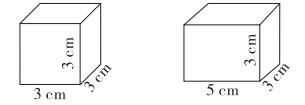

# Mathematics (Grade 5)

**ID**: d901a087
**难度**: hard
**题型**: fill_in_the_blank

## 题目
看图轻松回答。

（1）左图是（）体，右图是（）体。
（2）正方体有（）条棱，每条棱的长都是（）厘米；有（）个面，每个面都是完全一样的（）形。
（3）长方体的长是（）厘米，宽是（）厘米，高是（）厘米。它的（）面和（）面是正方形，边长是（）厘米；另外的（）个面是完全一样的长方形，长是（）厘米，宽是（）厘米。

## 解答

**答案**: 正方, 长方, 12, 3, 6, 正方, 5, 3, 3, 左, 右, 5, 4, 5, 3

1. Step1:观察左图，因其棱长均为3厘米，各棱长相等，所以左图是正方体
2. Step2:观察右图，其长为5厘米、宽为3厘米、高为3厘米，棱长不完全相等，所以右图是长方体
3. Step3:根据正方体的特征，可知正方体有12条棱，左图正方体棱长为3厘米，所以每条棱的长都是3厘米
4. Step4:根据正方体的特征，可知正方体有6个面，且每个面都是完全一样的正方形
5. Step5:观察右图长方体，可得长方体的长是5厘米，宽是3厘米，高是3厘米
6. Step6:观察右图长方体，其左面和右面的边长均为3厘米，所以它的左面和右面是正方形，边长是3厘米
7. Step7:观察右图长方体，除去左右两个面，另外的4个面是完全一样的长方形，长是5厘米，宽是3厘米

## 知识点

**知识点**:
  - 长、正方体的特征

---
