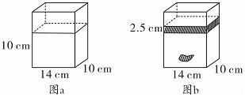

# Mathematics (Grade 5)

**ID**: d939781e
**难度**: hard
**题型**: fill_in_the_blank

## 题目
一个长方体水箱，从里面量长14cm，宽10cm，深16cm，之后加入10cm深的水（如图a），笑笑将一块石头放入水中，水面上升了2.5cm（如图b）。

1.加入石块后，石块和水的体积可看成一个长方体的体积，这个长方体长（）cm，宽（）cm，高（）cm。
2.当放入石块后，上升的水的体积可看作新增了一个长方体的体积（如上图中的阴影部分），新增的长方体长（）cm，宽（）cm，高（）cm。请计算石块的体积。

## 解答

**答案**: 14, 10, 12.5, 14, 10, 2.5, 350

1. Step1:已知长方体水箱从里面量长14cm，宽10cm，加入10cm深的水后放入石块水面上升了2.5cm，所以加入石块后，石块和水组成的长方体的长是水箱的长14cm
2. Step2:加入石块后，石块和水组成的长方体的宽是水箱的宽10cm
3. Step3:原来水高10cm，放入石块后水面上升2.5cm，所以加入石块后，石块和水组成的长方体的高是10 + 2.5 = 12.5cm
4. Step4:上升的水组成的新长方体的长是水箱的长14cm
5. Step5:上升的水组成的新长方体的宽是水箱的宽10cm
6. Step6:水面上升的高度就是上升的水组成的新长方体的高，即2.5cm
7. Step7:根据长方体体积公式，石块体积等于上升的水的体积，为14×10×2.5 = 350cm³

## 知识点

**知识点**:
  - 长、正方体体积的计算

---
