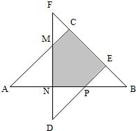

# Mathematics (Grade 5)

**ID**: dd890393
**难度**: hard
**题型**: fill_in_the_blank

## 题目
如图所示，两个等腰直角三角形ABC和DEF叠放在一起，如果BC=10，EF=8，CE=FC+BE，那么图中阴影部分的面积是$\underline{\hspace{5em}}$．

## 解答

**答案**: 26

1. Step1:根据已知条件BC=10，EF=8，CE=FC+BE，得出2FC+BE=8①，2BE+FC=10②
2. Step2:由①变形得到BE=8 - 2FC③
3. Step3:将③代入②，即2×（8 - 2FC）+FC=10，展开得16 - 4FC+FC=10，进一步得到3FC=6，解得FC=2
4. Step4:将FC=2代入③，算出BE=8 - 2×2=4
5. Step5:计算BF的长度，BF=2×（FC + BE）=2×（2 + 4）=12
6. Step6:根据阴影部分的面积=$S_{△FNB}$ - $S_{△CFM}$ - $S_{△PBE}$，分别计算$S_{△FNB}$=$\frac{1}{2}$×12×（$\frac{1}{2}$×12），$S_{△CFM}$=$\frac{1}{2}$×2×2，$S_{△PBE}$=$\frac{1}{2}$×4×4
7. Step7:计算阴影部分面积为$\frac{1}{2}$×12×（$\frac{1}{2}$×12） - $\frac{1}{2}$×2×2 - $\frac{1}{2}$×4×4=6×6 - 2 - 8=36 - 10=26

## 知识点

**知识点**:
  - 组合图形的面积．

---
