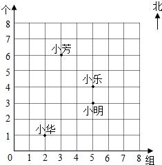

# Mathematics (Grade 5)

**ID**: e7ec7610
**难度**: hard
**题型**: fill_in_the_blank

## 题目
填一填

（1）小乐的位置用数对表示为（ $\underline{\hspace{5em}}$ ， $\underline{\hspace{5em}}$ ）．
（2）以小明为中心，在他正北方向的是 $\underline{\hspace{5em}}$ 同学．
（3）小华的位置在第 $\underline{\hspace{5em}}$ 组第 $\underline{\hspace{5em}}$ 个．
（4）以小乐为中心，小芳的位置在西偏北 $\underline{\hspace{5em}}$ 度的方向上．

## 解答

**答案**: 5, 4, 小乐, 2, 1, 45

1. Step1:根据数对表示位置的方法，第一个数字表示列，第二个数字表示行，观察图中小乐在第5列第4行，所以小乐位置用数对表示为（5，4），得到第一个和第二个空答案为5、4
2. Step2:依据地图上“上北下南，左西右东”的方向辨别方法，以小明为中心，观察图中其正北方向即正上方是小乐同学，得到第三个空答案为小乐
3. Step3:根据数对表示位置的方法，观察图中华华在第2列第1行，所以小华的位置在第2组第1个，得到第四个和第五个空答案为2、1
4. Step4:依据正方形的特征，以小乐为中心观察小芳位置，可知小芳的位置在西偏北45度的方向上，得到第六个空答案为45

## 知识点

**知识点**:
  - 数对与位置;方向

---
