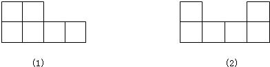

# Mathematics (Grade 5)

**ID**: f06496b7
**难度**: hard
**题型**: fill_in_the_blank

## 题目
在桌面上摆放着一些完全一样的正方体积木，摆完后从前面看如图（1），从左面看如图（2），要摆成这个样子最多要用$\underline{\hspace{5em}}$块积木，最少要用$\underline{\hspace{5em}}$块积木．

## 解答

**答案**: 20, 6

1. Step1:从前面看，可知立体图形有2层，第一层有4个小正方体，第二层有2个小正方体
2. Step2:从左面看，可知有4列，从右边数，第一列最多是6个小正方体，第二列最多是4个小正方体，第三列最多是4个小正方体，第四列最多是6个小正方体，计算最多时，将这四列的数量相加，即6 + 4 + 4 + 6 = 20个
3. Step3:考虑最少情况，从前面看有2层，第一层4个小正方体，第二层2个小正方体，通过把左边起第一列的2个小正方体向后平移3个格，把第三个小正方体向后平移2个格，把第四个小正方体向后平移1格，得出最少需要4 + 2 = 6个

## 知识点

**知识点**:
  - 从不同方向观察物体和几何体．

---
