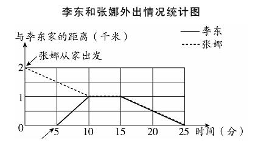

# Mathematics (Grade 5)

**ID**: fc061997
**难度**: hard
**题型**: fill_in_the_blank

## 题目
下面是李东和张娜外出情况的一张折线统计图。他们分别住在一条街的两端，距离2千米，在他们两家中间恰好有一家超市，现在根据下面的统计图回答问题。（从10分处两条折线开始重合）

（1）（）先从家出发。
（2）他们在超市停留了（）分，又走了（）分到（）家。
（3）张娜的速度一直保持在每分（）米。
（4）李东开始的速度是每分（）米，回家的速度是每分（）米。

## 解答

**答案**: 张娜, 5, 10, 李东, 100, 200, 100

1. Step1:观察折线统计图，张娜出发对应的时间为0分，李东出发对应的时间为5分，0分早于5分，所以先从家出发的是张娜
2. Step2:逛超市时距离不变，折线图中从10分到15分李东和张娜与李东家的距离不变，所以在超市停留的时间为15 - 10 = 5分
3. Step3:从15分到25分两人继续行走，所以又走的时间为25 - 15 = 10分，25分时两人到达李东家
4. Step4:两家相距2千米，张娜行走时间为去超市之前的10分和之后的10分，共10 + 10 = 20分，速度 = 路程÷时间，2÷20 = 0.1千米/分，1千米 = 1000米，0.1千米/分换算后为100米/分，所以张娜的速度一直保持在每分100米
5. Step5:李东去超市所用时间为10 - 5 = 5分，超市在两家中间，距离李东家1千米，速度 = 路程÷时间，1÷5 = 0.2千米/分，换算后为200米/分，所以李东开始的速度是每分200米
6. Step6:李东回家所用时间为25 - 15 = 10分，路程为1千米，速度 = 路程÷时间，1÷10 = 0.1千米/分，换算后为100米/分，所以李东回家的速度是每分100米

## 知识点

**知识点**:
  - 从统计图表中获取信息;简单的行程问题

---
