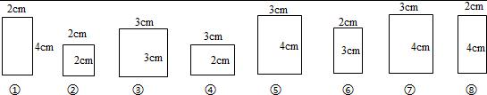

# Mathematics (Grade 5)

**ID**: 089150b2
**难度**: hard
**题型**: multiple_choice

## 题目
下面哪6个面能围成一个长4厘米、宽3厘米、高2厘米的长方体．（  ）

$\begin{description}
\item A．1、2、3、4、5、6\item B．1、3、5、6、7、8、\item C．1、4、5、6、7、8\item D．2、3、4、6、7、8
\end{description}$

## 解答

**答案**: C

1. Step1:明确长方体有6个面，且相对的面大小相等
2. Step2:确定围成给定长方体时，上面和下面应是长4厘米、宽3厘米的长方形
3. Step3:确定围成给定长方体时，前面和后面应是长4厘米、宽2厘米的长方形
4. Step4:确定围成给定长方体时，左面和右面应是长3厘米、宽2厘米的长方形
5. Step5:在选项中找出包含长4厘米、宽3厘米，长4厘米、宽2厘米，长3厘米、宽2厘米这三种长方形的选项组合
6. Step6:得出①④⑤⑥⑦⑧符合要求，对应的选项为C

## 知识点

**知识点**:
  - 长方体的展开图；长方体的特征．

---
