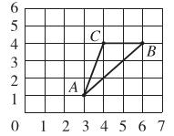

# Mathematics (Grade 5)

**ID**: 128e93c1
**难度**: hard
**题型**: multiple_choice

## 题目
如图，如果将△ABC向左平移2格，则顶点A的位置用数对表示为（）
A.（5，1）
B.（1，1）
C.（7，1）
D.（3，3）

## 解答

**答案**: B

1. Step1:明确平移方向为向左，平移格数为2格
2. Step2:观察图中顶点A原来的位置，其数对表示为(3, 1)
3. Step3:根据平移性质，向左平移时列数减小，行数不变
4. Step4:计算平移后顶点A的列数，3 - 2 = 1，行数不变仍为1
5. Step5:得出平移后顶点A的位置用数对表示为(1, 1)，所以答案选B

## 知识点

**知识点**:
  - 

---
