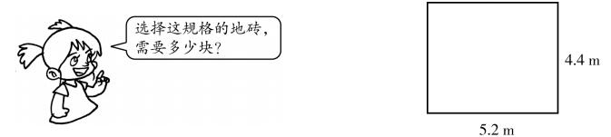

# Mathematics (Grade 5)

**ID**: 1359ae1c
**难度**: hard
**题型**: multiple_choice

## 题目
如图是王老师家的客厅，要选择一款规格的地砖来铺地，要保证地砖完整，应选规格（）。
A.30cm×30cm
B.40cm×40cm
C.50cm×50cm
D.60cm×60cm

## 解答

**答案**: B

1. Step1:将客厅长5.2m换算为520cm，因为1m = 100cm，5.2×100 = 520cm
2. Step2:将客厅宽4.4m换算为440cm，因为1m = 100cm，4.4×100 = 440cm
3. Step3:分析选项A，520÷30 = 17.33…，不能整除，所以30cm×30cm规格不符合要求
4. Step4:分析选项B，520÷40 = 13，440÷40 = 11，都能整除，所以40cm×40cm规格符合要求
5. Step5:分析选项C，520÷50 = 10.4，不能整除，所以50cm×50cm规格不符合要求
6. Step6:分析选项D，520÷60 = 8.66…，不能整除，所以60cm×60cm规格不符合要求
7. Step7:综上，应选B

## 知识点

**知识点**:
  - 公因数和最大公因数

---
