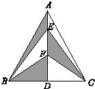

# Mathematics (Grade 5)

**ID**: 346d9e2b
**难度**: hard
**题型**: multiple_choice

## 题目
如图，在边长为4的等边三角形ABC中，AD是BC边上的高，点E、F是AD上的两点，则图中阴影部分的面积是（  ）
A．$4\sqrt{3}$
B．$3\sqrt{3}$
C．$2\sqrt{3}$
D．$\sqrt{3}$

## 解答

**答案**: C

1. Step1:根据等边三角形性质，在边长为4的等边三角形ABC中，AD是BC边上的高，可得BD = BC÷2 = 4÷2 = 2，AB = 4
2. Step2:在直角三角形ABD中，根据勾股定理AD = $\sqrt{AB² - BD²}$ = $\sqrt{4² - 2²}$ = $\sqrt{12}$ = $2\sqrt{3}$
3. Step3:根据三角形面积公式，求出等边三角形ABC的面积为S = BC×AD÷2 = 4×$2\sqrt{3}$÷2
4. Step4:由观察图形可知，右边阴影三角形EFC的面积与左边空白处三角形EFB的面积相等，所以阴影部分的面积等于等边三角形ABC面积的一半
5. Step5:计算阴影部分面积为4×$2\sqrt{3}$÷2÷2 = $2\sqrt{3}$，所以答案选C

## 知识点

**知识点**:
  - 组合图形的面积．

---
