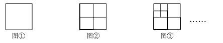

# Mathematics (Grade 5)

**ID**: 48c02909
**难度**: hard
**题型**: multiple_choice

## 题目
将正方形图①做如下操作：第一次，分别连结各边中点如图②，得到5个正方形；第2次，将图②左上角正方形按上述方法再分割如图③，得到9个正方形……以此类推，根据以上操作，若要得到49个正方形，需要操作的次数是（）。

A.12
B.13
C.14
D.15

## 解答

**答案**: A

1. Step1:分析第1次操作，连接各边中点得到4 + 1 = 5个正方形
2. Step2:分析第2次操作，将图②左上角正方形分割得到4×2 + 1 = 9个正方形
3. Step3:总结规律，得出第n次操作得到(4n + 1)个正方形
4. Step4:根据要得到49个正方形，列出方程4n + 1 = 49
5. Step5:解方程4n + 1 = 49，得到n = 12

## 知识点

**知识点**:
  - 图形中的规律

---
