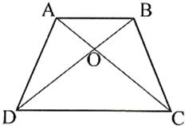

# Mathematics (Grade 5)

**ID**: 6a023e38
**难度**: hard
**题型**: multiple_choice

## 题目
如图，梯形ABCD的两条对角线相交于点O，图中一共有____对面积相等的三角形．(  )
A．4
B．3
C．2
D．1

## 解答

**答案**: B

1. Step1:根据梯形ABCD中AB∥DC，可知△ABC与△ADB等高同底，所以得出S_{△ABC}=S_{△ADB}
2. Step2:同理，因为AB∥DC，所以△BAD与△BDC等高同底，得出S_{△BAD}=S_{△BDC}
3. Step3:由于S_{△ABC}=S_{△ADB}，等式两边同时减去S_{△AOB}，即S_{△ABC}−S_{△AOB}=S_{△ADB}−S_{△AOB}，所以得到S_{△AOD}=S_{△BOC}
4. Step4:统计面积相等的三角形对数，有S_{△ABC}=S_{△ADB}，S_{△BAD}=S_{△BDC}，S_{△AOD}=S_{△BOC}，共3对

## 知识点

**知识点**:
  - 三角形的周长和面积;组合图形的计数．

---
