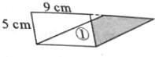

# Mathematics (Grade 5)

**ID**: 81dde416
**难度**: hard
**题型**: multiple_choice

## 题目
如图，已知①号三角形的面积是21cm$^{2}$，那么阴影部分的面积是（  ）cm$^{2}$．

A．24
B．22.5
C．45

## 解答

**答案**: A

1. Step1:因为长方形和平行四边形等底等高，根据面积公式，长方形面积S=ab（a为长，b为宽），这里长是9cm，宽是5cm，所以长方形面积为9×5 = 45cm²，也就知道了平行四边形面积是45cm²
2. Step2:已知①号三角形面积是21cm²，要求阴影部分面积，用平行四边形面积减去①号三角形面积，即45 - 21 = 24cm²
3. Step3:得出阴影部分面积是24cm²，答案选A

## 知识点

**知识点**:
  - 组合图形的面积．

---
