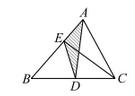

# Mathematics (Grade 5)

**ID**: a300f148
**难度**: hard
**题型**: multiple_choice

## 题目
如图所示，$S_{△ABC}$=1，若$S_{△BDE}$=$S_{△DEC}$=$S_{△ACE}$，则$S_{△ADE}$=（）。

A.$\frac{1}{8}$
B.$\frac{1}{7}$
C.$\frac{1}{6}$
D.$\frac{1}{5}$

## 解答

**答案**: C

1. Step1:因为$S_{△BDE}$=$S_{△DEC}$，且△BDE与△DEC等高，根据三角形面积公式S = $\frac{1}{2}$ah（a为底，h为高），面积相等且高相等时底相等，所以得出BD＝DC
2. Step2:由于BD＝DC，那么△ADC和△ABD等底等高，所以$S_{△ADC}$ = $S_{△ABD}$，又因为$S_{△ABC}$=1，所以$S_{△ADC}$＝$\frac{1}{2}$S_{△ABC}$=$\frac{1}{2}$
3. Step3:因为$S_{△BDE}$=$S_{△DEC}$=$S_{△ACE}$，$S_{△ABC}$=1，所以$S_{△BED}$＝$\frac{1}{3}$S_{△ABC}$=$\frac{1}{3}$
4. Step4:用$S_{△ABC}$的面积减去$S_{△ADC}$和$S_{△BED}$的面积，即$S_{△ADE}$=$S_{△ABC}$ - $S_{△ADC}$ - $S_{△BED}$=1 - $\frac{1}{2}$ - $\frac{1}{3}$ = $\frac{1}{6}$
5. Step5:根据计算结果，答案是$\frac{1}{6}$，对应的选项是C，所以答案选C

## 知识点

**知识点**:
  - 三角形的面积

---
