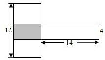

# Mathematics (Grade 5)

**ID**: ab7cee94
**难度**: hard
**题型**: multiple_choice

## 题目
两个长方形的纸条面积相等，重叠后图形的周长是（  ）

A．62
B．66
C．68

## 解答

**答案**: B

1. Step1:设阴影部分的长为X，根据两个长方形纸条面积相等，列出方程12x=4×（x+14）
2. Step2:解方程12x=4×（x+14），先展开括号得12x = 4x + 56，移项得12x - 4x = 56，即8x = 56，解得x = 7
3. Step3:明确重叠后图形的周长计算方法为左侧长方形的周长加上右侧小长方形的两条长的长度
4. Step4:计算左侧长方形周长为(7 + 12)×2 = 38，右侧小长方形两条长的长度为14×2 = 28
5. Step5:计算重叠后图形的周长为38 + 28 = 66

## 知识点

**知识点**:
  - 重叠问题．

---
