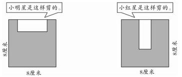

# Mathematics (Grade 5)

**ID**: bab74de0
**难度**: hard
**题型**: multiple_choice

## 题目
在一张长是8厘米的正方形纸中，用两种不同的方法减去一个长4厘米、宽2厘米的长方形（如图所示）。关于剩下的图形，下面说法正确的是（）。

A.周长一样，面积不一样
B.面积一样，周长不一样
C.周长一样，面积不一样

## 解答

**答案**: B

1. Step1:明确两个图形原来的正方形纸边长为8厘米，原来的面积和周长相同
2. Step2:计算剪去的长方形面积为2×4 = 8平方厘米，得出两个图形剩下图形的面积均为大正方形面积减去小长方形面积，所以剩下图形面积一样
3. Step3:观察小明星的剪法，发现剩下图形的周长增加了2个2厘米
4. Step4:观察小红星的剪法，发现剩下图形的周长增加了2个4厘米
5. Step5:得出两个图形剩下图形的周长不一样，所以答案是B

## 知识点

**知识点**:
  - 组合图形的面积;周长的认识

---
