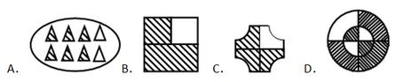

# Mathematics (Grade 5)

**ID**: cdd599e3
**难度**: hard
**题型**: multiple_choice

## 题目
下面的图中，（）幅图阴影的部分不是整体的$\frac{3}{4}$。

## 解答

**答案**: D

1. Step1:对于A图，把其中的三角形看作单位“1”，观察发现其被平均分成4份，阴影部分占3份，根据分数的意义，可得阴影部分是整体的$rac{3}{4}$
2. Step2:对于B图，把其中的正方形看作单位“1”，观察可知其被平均分成4份，阴影部分占3份，根据分数的意义，可知阴影部分是整体的$rac{3}{4}$
3. Step3:对于C图，把这个图形看作单位“1”，观察发现其被平均分成4份，阴影部分占3份，根据分数的意义，得出阴影部分是整体的$rac{3}{4}$
4. Step4:对于D图，把这个图形看作单位“1”，观察发现其被平均分成4份，阴影部分不占3份，根据分数的意义，可知阴影部分不是整体的$rac{3}{4}$
5. Step5:综上，阴影部分不是整体的$rac{3}{4}$的是D图，答案为D

## 知识点

**知识点**:
  - 分数的意义

---
