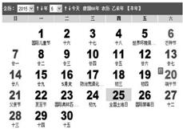

# Mathematics (Grade 5)

**ID**: 0381ee56
**难度**: hard
**题型**: short_answer

## 题目
（1）如图是今年6月份的日历，方玲的妈妈要在6月份连续出差4天，你能帮她算一算有多少种不同的安排吗？
（2）儿童节的早上，方玲去图书馆看了一会儿书后到游泳馆游泳．她每4天去一次图书馆，每5天去游泳一次，你知道下一次哪一天方玲到既到图书馆看书，又到游泳馆游泳吗？

## 解答

**答案**: 27, 6月21日

1. Step1:明确6月份有30天
2. Step2:对于连续出差4天的问题，根据公式总个数-每次圈出的数+1计算不同安排方法，即30 - 4 + 1 = 27种
3. Step3:判断4和5是互质数
4. Step4:计算4和5的最小公倍数为4×5 = 20
5. Step5:从6月1日开始往后推算20天，得出6月1日 + 20天 = 6月21日

## 知识点

**知识点**:
  - 排列组合；公因数和公倍数应用题．

---
