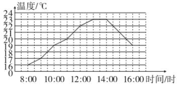

# Mathematics (Grade 5)

**ID**: 088c1b0f
**难度**: hard
**题型**: short_answer

## 题目
小明把昨天的气温变化记录到下面的统计图中。

（1）小明每隔（）小时测量了一次温度。
（2）这一天的温度有（）个小时不低于20摄氏度。
（3）10:00的温度是（），11:30的温度大约是（）。
（4）这一天什么时候的温度是19℃？
（5）这一天从8:00到16:00的气温总体上是如何变化的？
（6）你能猜猜这大约是什么季节吗？

## 解答

**答案**: 2, 4.5, 19℃, 21℃, 10:00，16:00, 先上升后下降, 春天

1. Step1:观察统计图横轴，相邻测量时间间隔为2小时，得出小明每隔2小时测量了一次温度
2. Step2:观察统计图，从纵轴上看，11:00到15:30温度不低于20摄氏度，11:00到15:30共4.5个小时，得出这一天的温度有4.5个小时不低于20摄氏度
3. Step3:从统计图上找到10:00对应的纵轴温度为19℃，找到11:30对应的纵轴大约温度为21℃，得出10:00的温度是19℃，11:30的温度大约是21℃
4. Step4:从统计图上找到温度为19℃的直线与折线统计图的交点对应的横轴为10:00和16:00，得出这一天10:00和16:00的温度是19℃
5. Step5:观察统计图中8:00到16:00的折线走势，得出这一天从8:00到16:00的气温总体上是先上升后下降
6. Step6:根据统计图中一天的最高气温是23℃，结合生活常识，得出大约是春天

## 知识点

**知识点**:
  - 从统计图表中获取信息;单式折线统计图

---
