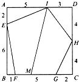

# Mathematics (Grade 5)

**ID**: 09632fce
**难度**: hard
**题型**: short_answer

## 题目
如图中ABCD是正方形，图中数字是各线段的长度(单位：厘米)．过I点的线段IM将五边形EFGHI分成面积相等的两部分．线段BM的长度是多少厘米？

## 解答

**答案**: 2.75

1. Step1:计算大正方形的面积，根据公式正方形面积=边长×边长，边长为(5+3)厘米，所以大正方形面积为(5+3)×(5+3)=64平方厘米
2. Step2:计算△IAE的面积，根据三角形面积公式三角形面积=底×高÷2，底为5厘米，高为2厘米，所以S_{△IAE}=5×2÷2=5平方厘米
3. Step3:计算△EBF的面积，底为6厘米，高为1厘米，所以S_{△EBF}=6×1÷2=3平方厘米
4. Step4:计算△IDH的面积，底为3厘米，高为4厘米，所以S_{△IDH}=3×4÷2=6平方厘米
5. Step5:计算△HCG的面积，底为4厘米，高为2厘米，所以S_{△HCG}=4×2÷2=4平方厘米
6. Step6:计算五边形EFGHI的面积，用大正方形面积减去四个小三角形面积，即64 - 5 - 3 - 6 - 4 = 46平方厘米
7. Step7:计算四边形EIMF的面积，因为线段IM将五边形EFGHI分成面积相等的两部分，所以四边形EIMF的面积为46÷2 = 23平方厘米
8. Step8:计算梯形MBAI的面积，梯形MBAI的面积等于四边形EIMF的面积加上△IAE的面积加上△EBF的面积，即23 + 5 + 3 = 31平方厘米
9. Step9:计算BM的长度，根据梯形面积公式逆用，梯形面积=(上底+下底)×高÷2，已知梯形MBAI的面积为31平方厘米，下底AI为6厘米，高AB为(2 + 6)厘米，所以BM = 31×2÷(2 + 6) - 5 = 2.75厘米

## 知识点

**知识点**:
  - 组合图形的面积．

---
