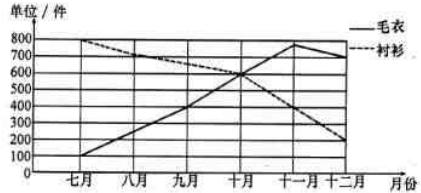

# Mathematics (Grade 5)

**ID**: 0e567b02
**难度**: hard
**题型**: short_answer

## 题目
下图是某服装店2009年下半年毛衣和衬衫销售情况统计图(    )

（1）看图说出毛衣在哪个月的销售量最大？衬衫呢？
（2）毛衣的销售量在哪个月增长最快？衬衫的销售量是怎样变化的？毛衣呢？

## 解答

**答案**: 十一月份, 七月份, 九月份到十月分, 七月份开始，到十二月份销售一直呈下降的趋势, 七月份开始到十一月份一直呈上升的趋势，从十一月到十二月呈下降的趋势

1. Step1:观察复式折线统计图，实线代表毛衣，找到实线的最高点对应的月份，可知毛衣在十一月份销售量最大
2. Step2:观察复式折线统计图，虚线代表衬衫，找到虚线的最高点对应的月份，可知衬衫在七月份销售量最大
3. Step3:观察毛衣销售量折线，看哪段折线上升最快，得出毛衣在九月份到十月份销售增长最快
4. Step4:观察衬衫销售量折线走势，得出衬衫从七月份开始，到十二月份销售一直呈下降的趋势
5. Step5:观察毛衣销售量折线走势，得出毛衣从七月份开始到十一月份一直呈上升的趋势，从十一月到十二月呈下降的趋势

## 知识点

**知识点**:
  - 从统计图表中获取信息；单式折线统计图．

---
