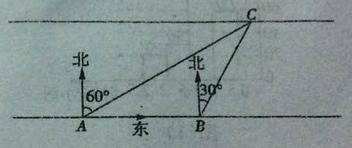

# Mathematics (Grade 5)

**ID**: 114561a6
**难度**: hard
**题型**: short_answer

## 题目
如图，甲、乙两人在道路的两边相向而行，当甲、乙两人分别行至点A、C时，测得乙在甲的北偏东60方向上．乙留在原地休息，甲继续向前走40米，此时测得乙在其于上偏东30°方向上．当甲继续向前走，他离乙的最短距离是多少？(参考数据：在≈1.732)

## 解答

**答案**: 36.64

1. Step1:根据题意，求甲离乙的最短距离即求垂线段的距离，所以过点C作CD⊥AB，垂足为D
2. Step2:由题意可知∠CAB = 30°，∠BCD = 30°
3. Step3:设CD = x，在Rt△BCD中，根据正切函数定义，tan30° = BD/CD，所以BD = ($\sqrt{3}$/3)x
4. Step4:在Rt△ACD中，根据正切函数定义，tan30° = CD/AD，所以AD = $\sqrt{3}$x
5. Step5:因为AB = 40米，且AD - BD = AB，所以$\sqrt{3}$x - 40 = ($\sqrt{3}$/3)x
6. Step6:求解方程$\sqrt{3}$x - 40 = ($\sqrt{3}$/3)x，得出x = 36.64，即他离乙的最短距离是36.64米

## 知识点

**知识点**:
  - 

---
