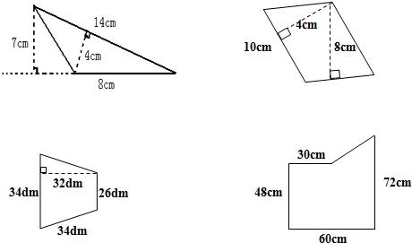

# Mathematics (Grade 5)

**ID**: 16761a3a
**难度**: hard
**题型**: short_answer

## 题目
计算下面图形的面积（单位：厘米） 

## 解答

**答案**: 28, 40, 960, 3240

1. Step1:计算第一个图形（三角形）的面积，底为8厘米，高为7厘米，根据三角形面积公式S=底×高÷2，即8×7÷2=28平方厘米
2. Step2:计算第二个图形（平行四边形）的面积，底为10厘米，高为4厘米，根据平行四边形面积公式S=底×高，即10×4=40平方厘米
3. Step3:计算第三个图形（梯形）的面积，上底为26分米，下底为34分米，高为32分米，根据梯形面积公式S=(上底+下底)×高÷2，先算26+34=60分米，再算60×32÷2=960平方分米
4. Step4:计算第四个图形的面积，将其分成一个长方形和一个三角形，长方形长60厘米，宽48厘米，面积为60×48=2880平方厘米；三角形底为72 - 48 = 24厘米，高为60 - 30 = 30厘米，面积为24×30÷2=360平方厘米，两者相加2880 + 360 = 3240平方厘米

## 知识点

**知识点**:
  - 三角形的周长和面积;平行四边形的面积;梯形的面积

---
